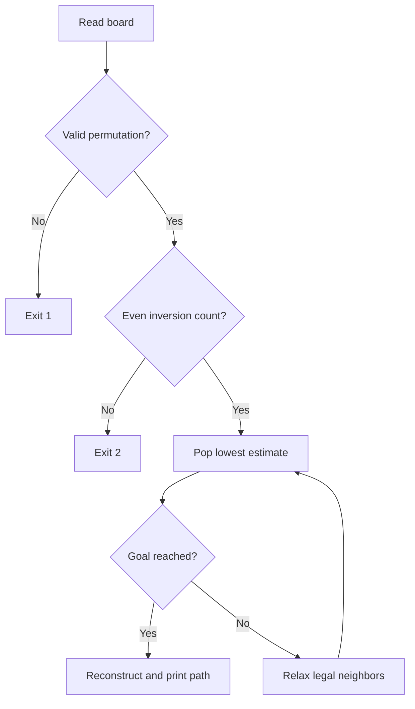

# Eight Puzzle Solver: project walkthrough

[Overview](../README.md) · [Code reference](CODE_REFERENCE.md) · [Development guide](DEVELOPMENT.md)

## Read the implementation in this order

Start with [main](../8_Puzzle.cpp) to see the input contract, then `solvable`, `manhattan`, `State`/`LowestEstimateFirst`, and finally `solve`. The whole application is one C++ source file; there is no hidden service or external solver.

## Repository map

| Path | Responsibility |
| --- | --- |
| [8_Puzzle.cpp](../8_Puzzle.cpp) | Validation, A* search, and printed solution boards |
| [input.txt](../input.txt) | Original sample input; inspect its format before redirecting it into the program |
| [prog1_output.txt](../prog1_output.txt) | Historical placeholder, not the current program's output destination |
| [8_Puzzle.exe](../8_Puzzle.exe) | Preserved historical Windows binary |
| [tests/test_solver.py](../tests/test_solver.py) | Compiles the source and checks paths through a separate Python harness |

## Objects and state

`Board` is `std::array<int, 9>` in row-major order. Zero represents the blank; the goal is `(1,2,3,4,5,6,7,8,0)`. A `State` carries a board, the number of moves already made, and its estimated total cost. `LowestEstimateFirst` makes the priority queue pop the smallest estimate first; equal estimates prefer the deeper state.

`best_moves` maps a board to the cheapest discovered path length. `parents` maps a board to the previous board on that path. They are local to a call to `solve`, so a later search does not inherit earlier visited state.

The priority is `f = g + h`: `g` is the state's actual move count and `h` is Manhattan distance, excluding the blank. For each nonzero tile, its value determines its goal row and column. Moving the blank only one square produces the candidate neighbors; horizontal moves are checked against row wrapping.

## Search decisions

When a queued entry no longer matches `best_moves`, the search skips that stale entry. A neighbor is inserted only if it is new or its move count improves. On reaching the goal, `parents` is followed backward, then the resulting list is reversed for display.

## Follow one example

Input `1 2 3 4 5 6 7 0 8` has the blank immediately left of tile 8. Its heuristic is one; swapping the blank right reaches the goal. The output reports `Solution: 1 moves`, followed by the starting and goal boards. Output goes to standard output; the program does not write `prog1_output.txt`.

## Evidence and boundaries

The Python tests compile with warnings treated as errors, compare sampled states against an independent breadth-first search out to depth eight, verify every printed step, and check a known hardest-distance example. This supports the tested search behavior; it is not a performance benchmark across every solvable board. Invalid permutations return 1 and inversion-parity failures return 2. See the [development guide](DEVELOPMENT.md) for build details.
